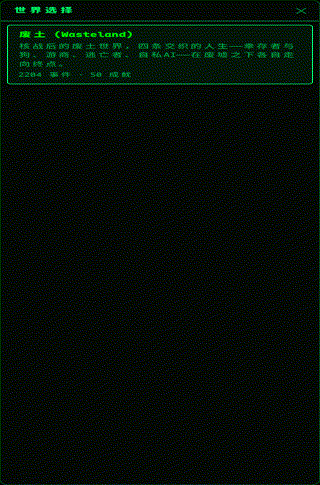
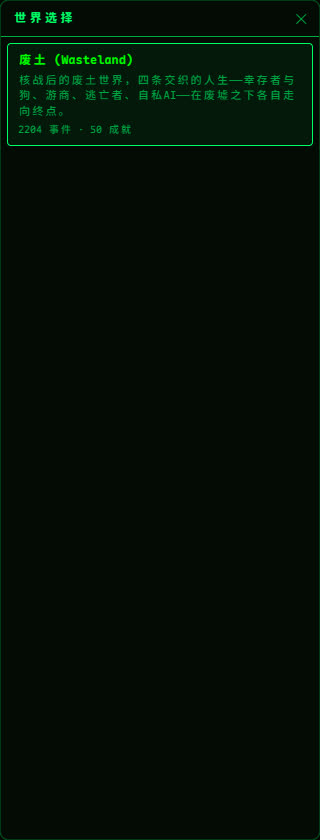
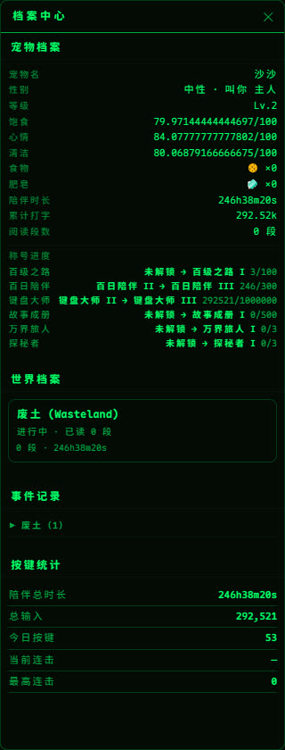
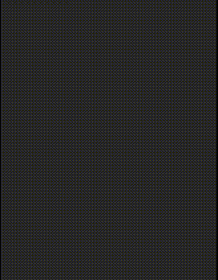
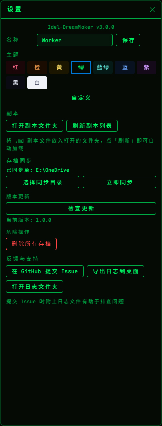

# Idel-DreamMaker

> 原名 IdleWorker，v0.3.0 起改名 Idel-DreamMaker。

## 这是什么？

Idel-DreamMaker 是一个藏在系统托盘里的**宠物陪伴挂机游戏**。宠物常驻桌面，你挂机、打字，它就陪着你——故事按挂机时长慢慢解锁，宠物会饿、会脏、会想你，需要你喂食和洗澡。

**核心玩法：**
1. 选一个故事世界，挂机 20 分钟解锁一段剧情
2. 关键节点做选择，影响故事走向
3. 打字攒食物和肥皂，喂食/洗澡养宠物
4. 宠物会说话——点击它就有反应，还可以给它设置性别和称谓
5. 解锁阶梯成就和称号，看一段完整的人生

每个世界是一段完整的旅程——共享开篇 + 多条分支路线 + 全通关后解锁的隐藏线。目前内置了「废土」世界（重做中），你也可以自己写副本、用 AI 辅助创作，或导入别人分享的。

## 适合谁？

| 人群 | 为什么适合 |
|------|-----------|
| **上班族/学生党** | 挂在系统托盘里，偶尔瞄一眼发生了什么，不耽误工作学习 |
| **喜欢看故事的人** | 每个世界 1000+ 段剧情，纯文字叙事，零操作打断 |
| **像素宠物爱好者** | 支持 PetDex 社区精灵，宠物常驻桌面互动 |
| **爱折腾的玩家** | 自己写 .md 副本文件丢进去就是新游戏，也可以分享给别人 |
| **闲得慌的人** | 挂着看故事慢慢展开，有种奇妙的满足感 |

## 特色功能

| 功能 | 说明 |
|------|------|
| **宠物常驻桌面** | 启动只显示宠物窗口，双击/右键交互，缩在托盘里不占空间 |
| **故事按挂机时长解锁** | 挂机 20 分钟解锁一段，打字还能加速，摸鱼时间慢慢看 |
| **饲养宠物** | 饱食/心情/清洁三维状态，打字攒食物（🍪）和肥皂（🧼），喂食洗澡即时反馈 |
| **宠物会说话** | 点击宠物随机闲聊，饿/脏/心情差各有专属台词；可设性别（男孩/女孩）和称谓（默认"主人"） |
| **世界系统** | 每个世界独立旅程：共享开篇 + 2-4 条分支 + 全通关解锁隐藏线，多结局 |
| **阶梯成就** | 等级/陪伴时长/打字/阅读/通关五条阶梯，档位无限延伸，里程碑 + 世界成就 |
| **旅程称号** | 序章/首次抉择/通关分支/全分支/隐藏链按进度解锁，通关另有专属称号 |
| **自制副本** | 写个 .md 文件丢进 scenarios_user/，在设置面板点「刷新」即可加载 |
| **挂机变体** | 不同世界有不同机制（修仙白天快晚上慢、潮汐每 6 小时一波……）|
| **打字陪伴** | 全局键盘+鼠标监听，宠物头顶随机弹出按键或点击字符 + 连击数，段位系统驱动 EXP 倍率 |
| **Buff 爆发** | 高速打字触发 buff（B→x2 / A+→x3），配合连击快速解锁剧情 |
| **分支叙事** | 关键节点弹选择气泡，不选不推进剧情，选后故事走向不同 |
| **存档同步** | 设置面板选云盘目录，存档自动双写本地+云端，跨设备无缝衔接 |
| **整点报时** | 每半小时宠物气泡报时，显示当前时间，6 秒自动消失，可右键关闭 |
| **节日彩蛋** | 春节/清明/中秋等 22 个节日，宠物会说应景的话 |
| **多主题** | 9 套配色 + 自定义调色，总有一款顺眼 |
| **跨平台** | Windows / macOS / Linux 均可正常使用 |

## 截图

| 宠物窗口（悬停显示状态条） | 世界选择 | 档案中心 |
|---------|-----------|---------|
|  |  |  |

| 打字连击 | 存档同步 |
|---------|---------|
|  |  |

## 下载

从 [Releases](https://github.com/sandsand244263/idel-dream-maker/releases) 页面下载最新版。

| 平台 | 文件 | 说明 |
|------|------|------|
| Windows | `Idel-DreamMaker-*-win.zip` | 解压后运行 `Idel-DreamMaker.exe` |
| Windows | `Idel-DreamMaker.*.exe` | 单文件便携版，下载即用 |
| Linux | `idel-dream-maker-*.tar.gz` | 解压后运行 `idel-dream-maker` |
| macOS | `Idel-DreamMaker-*-arm64.dmg` | 打开后将应用拖入 Applications 文件夹 |

### macOS 用户注意

因无 Apple 开发者签名，系统 Gatekeeper 会拦截。解决方法（三选一）：

1. 右键（或按住 Ctrl 点击）应用 → 选择「打开」
2. 如果系统提示"已损坏"，终端运行：
   ```bash
   sudo xattr -rd com.apple.quarantine /Applications/Idel-DreamMaker.app
   ```
3. 系统设置 → 隐私与安全性 → 仍要打开

## 存档同步

v3.0.0 支持将存档同步到云盘，在多台电脑之间接力游戏。

**如何设置：**
1. 在所有电脑上安装云盘客户端并登录
2. 在云盘里创建一个文件夹（如 `D:\阿里云盘\Idel-DreamMaker\`）
3. 打开游戏 → 设置 → 存档同步 → 选择该文件夹
4. 游戏会自动在云盘里创建 `Idel-DreamMaker-Sync` 文件夹，包含存档和日志
5. 在另一台电脑上同样设置，启动时会提示导入

**推荐的免费云盘（都支持文件夹自动同步）：**

| 云盘 | 免费空间 | 说明 |
|------|---------|------|
| **阿里云盘** | ~100GB | 速度快，同步盘客户端稳定，推荐 |
| **OneDrive** | 5GB | Windows 自带，登录即用 |
| **坚果云** | 1GB/月上传流量 | 专业同步盘，稳定可靠 |
| **iCloud** | 5GB | 苹果用户首选 |

> 存档文件很小（几十 KB），一年也涨不到 1MB，任何云盘都绰绰有余。

## 开发者：快速开始

```bash
# 安装依赖
npm install

# 构建副本数据 + 启动开发模式
npm run electron:dev
```

## 制作自己的副本

1. 在 `scenarios/` 或 `scenarios_user/` 下创建一个 `.md` 文件
2. 按照 `docs/format-rules.md` 的格式填写
3. 重启游戏即可自动加载

详情见 [创建副本指南](docs/creating-scenarios.md)。

## 打包

```bash
npm run electron:build
```

Windows 打包 → `release/Idel-DreamMaker 版本.exe`
Linux 打包 → `npx electron-builder --linux`

## 技术栈

| 类别 | 技术 |
|------|------|
| 桌面框架 | Electron 34.x |
| 后端 | JavaScript (Node.js 22.x) |
| 前端 | HTML + CSS + JS（无框架） |
| 构建 | Vite 6.x + electron-builder 25.x |
| 全局输入 | [uiohook-napi](https://github.com/SnosMe/uiohook-napi) |
| 字体 | [Maple Mono NF CN](https://github.com/subframe7536/maple-font) (OFL-1.1) |

## 文档

- [副本格式规范](docs/format-rules.md)
- [创建副本教程](docs/creating-scenarios.md)
- [AI 辅助创作模板](docs/ai-prompt-template.md)

## 文件结构

```
index.html              主 HTML 入口
src/main.js             前端逻辑
src/style.css           前端样式
src/scenario.js         数据模型模块
src/scenario-parser.cjs 副本 .md 解析器（共享模块）
electron/
  main.cjs              Electron 主进程（窗口、游戏循环、存档）
  preload.cjs           IPC 桥接
  tray.cjs              系统托盘
  windows.cjs           窗口管理
  pet.cjs               宠物窗口
  holiday.cjs           节假日模块
  *.cjs                 其他子窗口管理
pet/                    宠物窗口前端
pet-bubble/             事件气泡窗口
pet-context-menu/       右键菜单窗口
pet-selector/           宠物选择器窗口
scenarios/              内置副本 .md 源文件
scenarios_user/         玩家自制副本（新建，已 gitignore）
scenarios_wip/          副本制作中工作区（状态文件/分段文件，已 gitignore）
ai/ScenarioWriter/      AI 副本创作 skill（原创/改编/续写三模式）
public/
  scenarios_data.json   构建时生成的副本数据（由 build.js 从 scenarios/ 生成）
  fonts/                打包字体
docs/                   文档
build.js                副本构建脚本
merge.cjs               分段文件合并脚本
validate_flags.cjs      flag 引用链校验
validate_md.cjs         .md 格式校验
validate_quality.cjs    内容质量校验（ID/等级覆盖/伏笔回收率）
test-utils.cjs          AI 测试工具（dev 存档操作）
mcp-server.cjs          AI 测试 MCP 服务（--dev）
level-curve.cjs         升级曲线共享公式
```

## 版权声明

- 像素宠物精灵为玩家自行下载的用户数据（`%APPDATA%/Idel-DreamMaker/pets/`）。应用不捆绑、不分发任何精灵文件。精灵版权归各自创作者或 IP 权利人。下载地址：https://petdex.dev/
- 字体 [Maple Mono NF CN](https://github.com/subframe7536/maple-font) 使用 SIL Open Font License 1.1
